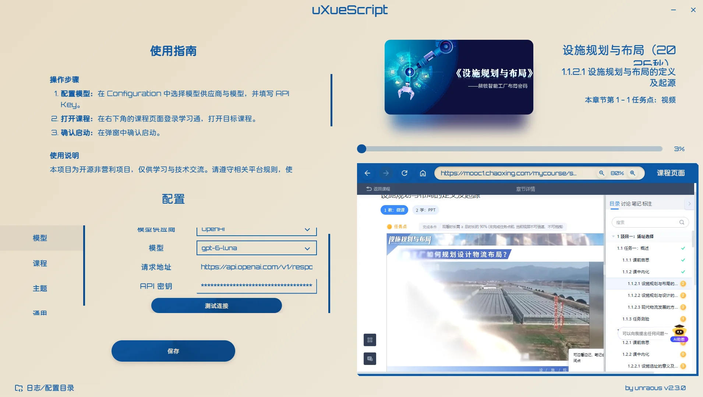

<h1 align="center">uXueScript for UCAS Online</h1>

<p align="center">
  
</p>

<p align="center">
  <strong>简单上手，舒心刷课。</strong><br>
  课程任务自动推进 · AI 辅助答题 · 现代桌面体验 · 独立脚本支持
</p>

<p align="center">
  <a href="https://github.com/unraous/uxuescript/releases/latest"></a>
  <a href="https://github.com/unraous/uxuescript/stargazers"></a>
  
  
  
  
  
  <a href="https://hub.xerj.org/contributors/unraous"></a>
</p>

<p align="center">
  <a href="https://github.com/unraous/uxuescript/releases/latest">下载最新版本</a> ·
  <a href="docs/usage/desktop.md">桌面端使用</a> ·
  <a href="docs/usage/ai.md">智能答题</a> ·
  <a href="docs/backend-free.md">无后端模式</a> ·
  <a href="docs/architecture/overview.md">架构概览</a> ·
  <a href="https://github.com/unraous/uxuescript/issues">反馈问题</a>
</p>

---

## 本项目说明

本仓库是面向**国科大在线**的 uXueScript 油猴脚本适配版，基于上游项目 [uXueScript](https://github.com/unraous/uxuescript) 开发。uXueScript 延续了旧版 [uXuexitongJS](https://github.com/unraous/uxuescript/tree/history) 的思路；原项目作者、许可证和主要课程自动化能力均予以保留，新增内容集中在国科大在线页面适配。

本项目目前支持：

- 学习通原有课程页面的视频、音频和 PDF 任务点处理。
- 国科大在线课程页面 `mooc.mooc.ucas.edu.cn` 的课程目录与章节处理。
- 国科大在线 PDF 阅读器 `pan.mooc.ucas.edu.cn` 的跨域页面通信和自动翻页。
- 识别已完成的 PDF 任务点并跳过，完成当前 PDF 后继续进入下一节。

### 工作分工

- **用户完成：** 提出国科大在线支持需求，提供 Edge 中的实际学习页面用于调查，并进行功能测试，反馈已完成 PDF 跳过和章节跳转等实际问题。
- **GPT 完成：** 根据实际页面结构调整油猴脚本匹配范围，增加国科大课程目录异步等待、章节框架处理和跨域 PDF `postMessage` 握手；补充 PDF 完成状态判断、任务点推进逻辑、回归测试，并重新构建油猴脚本。

### 安装与构建

安装依赖后运行：

```bash
pnpm install
pnpm build:scripts
```

然后将生成的 `dist/scripts/uxuescript.user.js` 导入 Tampermonkey。脚本源码位于 [`injected/`](injected/)，构建和回归测试命令见[开发与构建指南](docs/development/build.md)及[测试说明](tests/README.md)。

本项目仅用于个人学习、软件工程研究和自动化技术交流，请遵守相关平台规则。

uXueScript 是基于 **Rust + Tauri 2 + Vue 3** 开发的学习通自动化辅助客户端，支持课程任务自动推进与 AI 辅助答题。课程页面、配置面板与进度展示集中在一个窗口中，搭配多种配色主题和界面动效，让重复的课程操作也能有个舒服的使用体验。

> 项目正在快速迭代中。遇到问题，或者希望增加什么功能，欢迎通过 [Issue](https://github.com/unraous/uxuescript/issues) 或[邮件](mailto:unraous@qq.com)告诉作者。也欢迎参与开发、测试和文档维护，一起把项目做得更好。

## 运行预览

<p align="center">
  
</p>

## 功能与特点

- **课程任务自动推进：** 识别章节目录与任务状态，跳过已完成内容，顺序处理视频、音频、PDF 和章节测验。PDF 自动滚动阅读并等待任务点完成；目录中后续解锁的章节可接续处理。
- **视频自动处理：** 支持静音、锁定倍速和可识别的互动题处理；批注弹出时自动点击“继续学习”，无需配置模型。桌面端、油猴脚本和控制台脚本均支持。
- **AI 辅助答题：** 支持单选、多选、判断、填空和简答题，独立作业与考试还支持连线题。自动提取题目并尝试还原混淆文字，调用所选模型生成参考答案后回填。
- **答题失败恢复：** 模型返回无效 JSON 或答案不完整时，自动重试失败批次；遇到服务限流时，自动等待并降低本次求解的请求并发。重试后仍失败会汇总原因，本次不回填或提交。
- **模型自由选择：** 内置多家模型供应商，支持自定义 OpenAI 兼容服务和本地模型。按自己的需求选择服务与模型，无需 AI 答题时可以跳过配置。
- **现代桌面体验：** 在同一个窗口中查看课程、调整配置和跟踪进度，支持多种配色主题。无需额外安装脚本管理器、Python、Selenium 或浏览器驱动。
- **后台运行：** 处理页面失焦导致的暂停行为；部分电脑最小化后仍可能冻结课程页，可保持窗口不最小化并切换到其他应用。
- **双模式运行：** 桌面端提供配置、进度展示和 AI 答题能力；单文件 `core.js` 可直接复制到浏览器控制台，运行已支持的非测验类任务。

### 章节测验

随课程任务自动处理，生成答案并填写后自动提交。需要先检查答案时，可开启 **Course → Review Answers（人工核验）**，由用户确认后再提交。

### 独立作业

在桌面客户端中打开需要完成的作业，进入实际答题页，按提示确认启动。程序会读取整页题目，调用已保存的模型生成答案，自动填写并调用学习通的**暂存**功能。

完成后会弹出提示，由你检查、修改答案，补充未支持的题型，再点击页面上的提交按钮。**程序不会自动提交作业**，也不受章节测验的 Review Answers 开关影响。

### 考试辅助答题

在桌面客户端中进入考试答题页，程序根据考试是否允许整卷预览，选择对应的处理方式：

| 考试页面 | 程序如何处理 | 完成后需要做什么 |
| --- | --- | --- |
| **允许整卷预览** | 自动进入整卷预览页，询问是否开始；确认后读取整卷题目、生成答案并填写 | 检查、修改答案，**自行保存并交卷** |
| **不允许整卷预览** | 需从第一题启动；先自动逐题翻页采集整卷，生成答案后返回第一题，再逐题填写并暂存 | 等待填写和暂存完成，检查、修改答案后**自行交卷** |

逐题模式的第一遍只采集题目，第二遍才填写答案，请等待完整流程结束。运行中不要手动跳题；在当前窗口刷新同一题可以继续已保存的步骤，报错后需从第一题重新启动。

逐题模式仅支持**允许自由回看、作答顺序不受限制的普通考试**；限制回看、单题或分组限时等模式不支持。程序不会自动交卷，**平台倒计时及到时自动提交仍然生效**，请自行留意剩余时间。

作业与考试均需先配置并保存模型，支持单选、多选、判断、填空、简答和连线题；未支持的题型会在结束提示中列出，需人工完成。模型答案仅供参考，详细说明见[智能答题指南](docs/usage/ai.md#作业与考试)。

## 快速开始

### 方式一：直接运行发行包 (推荐)

1. 前往 [Releases 页面](https://github.com/unraous/uxuescript/releases/latest) 下载对应系统的安装包或便携程序。
2. 按所选包完成安装或直接运行便携程序。
3. 在左侧 **Configuration** 中配置 **Provider**、**Model** 与 **API Key** 并保存（如无需 AI 答题可跳过）。
4. 在右侧内嵌 WebView 中登录学习通，进入目标课程小节、作业或受支持的考试答题页。
5. 脚本加载后，在课程区域的客户端确认遮罩中点击 **Yes** 即可开始自动处理，点击 **No** 取消。作业与考试完成后，按提示检查、保存并自行提交。

Windows 用户可选择 MSI 安装包或便携 EXE；macOS Apple Silicon 用户下载 DMG。

详细操作参见[桌面端使用指南](docs/usage/desktop.md)。

### 方式二：从源码构建

开发环境、启动命令和打包步骤见[开发与构建](docs/development/build.md)。

## 独立脚本

[安装油猴脚本](https://github.com/unraous/uxuescript/releases/latest/download/uxuescript.user.js) · [下载 core.js](https://github.com/unraous/uxuescript/releases/latest/download/core.js) · [查看源码](injected/chaoxing/course.js)

安装油猴脚本后，进入课程学习页面会自动询问是否启动。也可以将 `core.js` 的完整内容复制到课程页面的浏览器控制台执行。两种方式均支持已实现的视频、音频和 PDF 任务，包括可识别的视频内互动题与批注自动继续学习。

独立模式不提供依赖桌面后端的课后测验 AI 答题。操作步骤见[独立脚本说明](docs/backend-free.md)。

## 技术与架构

客户端使用系统 WebView 加载课程页面，通过脚本处理课程任务。Rust 后端负责配置管理、混淆字体还原与模型调用，核心脚本同时支持客户端注入和浏览器独立运行。

题目处理会解析学习通的 `font-cxsecret` 动态混淆字体，通过 TTF 字形轮廓特征匹配还原文本，再交给所选模型生成参考答案。运行环境与职责划分见[架构概览](docs/architecture/overview.md)。

项目源自旧版 [uXuexitongJS](https://github.com/unraous/uxuescript/tree/history)。

也可通过 [DeepWiki](https://deepwiki.com/unraous/uxuescript) 浏览项目解读。

## 使用须知与边界说明

- **平台支持：** 目前主要在 Windows（x64）环境下测试与验证；macOS 与 Linux 平台的支持处于持续完善中。
- **免责声明：** 本项目仅供个人学习、软件工程研究与自动化技术交流，不对使用本工具造成的任何后果承担责任。请遵守相关使用规范，严禁用于任何违规用途。
- **AI 答题局限：** 模型生成的答题结果受模型自身知识与题目类型限制，仅供参考，无法保证正确率。
- **凭据安全：** API Key 保存在本地配置文件中；调用模型服务时，会作为请求认证信息发送到所配置的 API 地址。请仅配置可信服务，不要分享包含密钥的配置文件。

## 文档导航

- [桌面端使用指南](docs/usage/desktop.md)：课程选项、启动与停止、进度查看。
- [智能答题指南](docs/usage/ai.md)：供应商、模型、自定义服务与本地 Ollama 配置。
- [无后端模式说明](docs/backend-free.md)：如何在任意浏览器的开发者控制台直接执行单文件脚本。
- [架构概览](docs/architecture/overview.md)：运行环境、职责边界与关键交互契约。
- [故障排查](docs/troubleshooting.md)：课程启动、模型连接、本地配置与日志位置。
- [开发与构建指南](docs/development/build.md)：环境、配置同步、IPC 生成与打包。
- [测试说明](tests/README.md)：测试分组、执行入口与按需外部联测。
- [发布与镜像](docs/development/release.md)：标签发布、签名、Gitee 同步与失败重试。

## 反馈与贡献

欢迎提交 Issue 与 Pull Request：

- 遇到问题或页面不兼容，请在 [GitHub Issues](https://github.com/unraous/uxuescript/issues) 提交包含复现步骤、课程类型与控制台日志的反馈。
- 联系邮箱：<unraous@qq.com>。

## Star History

<a href="https://www.star-history.com/#unraous/uxuescript&Date">
  <picture>
    <source media="(prefers-color-scheme: dark)" srcset="https://api.star-history.com/svg?repos=unraous/uxuescript&amp;type=Date&amp;transparent=true&amp;theme=dark">
    <source media="(prefers-color-scheme: light)" srcset="https://api.star-history.com/svg?repos=unraous/uxuescript&amp;type=Date&amp;transparent=true">
    
  </picture>
</a>

## 开源许可证

本项目核心源代码依据 [GNU GPL v3.0](LICENSE) 许可证开源发布。  
第三方字体、字形特征哈希表与依赖库声明请参阅 [THIRD_PARTY_NOTICES.md](THIRD_PARTY_NOTICES.md)。
