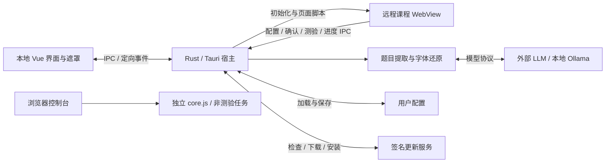

# 架构概览

uXueScript 有三个运行环境：本地 Vue 界面、Rust/Tauri 宿主、远程课程页面。课程自动化脚本另有可直接复制执行的浏览器模式。理解它们的职责与通信边界，是修改项目的起点。

## 宿主、界面与 WebView

Rust 宿主拥有窗口、配置和共享状态；Vue 界面通过生成的 IPC 客户端操作它们。课程页面运行在独立的远程 WebView 中，不属于 Vue 的 DOM。

| WebView | 职责 |
| --- | --- |
| `main` | 本地配置、课程仪表盘与导航控制 |
| `chaoxing` | 学习通页面与课程自动化 |
| `mask` | 全窗口开屏、确认、退出和更新下载展示 |
| `chaoxing-mask` | 覆盖课程区域的启动确认 |

窗口与各 WebView 在开屏前已创建，课程页也已开始导航。遮罩监听就绪后显示窗口，动画再显示内容；显示内容不触发课程页重新加载。课程确认与全窗口确认分别处理，课程导航开始时结束旧页面的确认。

课程页与课程遮罩共享原生位置和尺寸，并与 Vue 的比例布局对齐。调整课程区域时，需同时检查原生几何和 CSS；仅改变其中一侧会破坏覆盖关系。

课程仪表盘消费定向发送到 `main` 的进度事件，不独立查询平台完成状态。页面加载完成时先重置状态，课程脚本启动后再持续报告。共用的遮罩组件在各自 WebView 内管理展示与事件。

入口：[窗口与生命周期](../../src-tauri/src/app/window.rs)、[WebView 创建](../../src-tauri/src/app/webview.rs)、[主布局](../../src/layouts/TheMainLayout.vue)、[遮罩交互](../../src/TheMaskManager.vue)。

## IPC 与权限

Rust 命令声明是注册、TypeScript 绑定和应用命令权限的共同来源。`uxs_commands` 扫描命令模块，生成 handler 与各 WebView 的 allowlist；绑定通过 Tauri Specta 导出。修改命令或 DTO 应沿此管线同步，不手改生成文件。

能力按 WebView 标签及远程来源配置。课程页不会因与主界面共享窗口而继承主界面的权限；其有效能力还包含显式授予的插件权限，不能只看应用命令 allowlist。允许页面导航的 URL 分类与允许远程 IPC 的来源匹配是两套规则，需要分别检查。

入口：[命令声明](../../src-tauri/src/commands.rs)、[生成宏](../../src-tauri/crates/uxs_commands/src/lib.rs)、[能力配置](../../src-tauri/capabilities)、[前端绑定](../../src/services/cmds.ts)。同步操作见[构建指南](../development/build.md)。

## 配置归属

| 数据 | 归属与生效方式 |
| --- | --- |
| 版本、应用标识、更新端点及安装器共享值 | `config/build.json` 经同步脚本写入各构建配置 |
| 应用显示信息、课程首页与安装器参数 | 运行时读取已同步的 Tauri 配置或包信息 |
| 模型、课程选项、主题等用户偏好 | 加载到 Rust 配置状态，由命令修改并保存到本地 TOML |

界面操作先修改内存配置，显式保存和正常退出才写入磁盘。加载时补齐缺失的内置供应商；用户配置中的 `version` 用于升级迁移，不决定应用显示版本。升级时会刷新已有内置供应商的模型预设，并尝试按名称保留模型选择，自定义供应商不走此刷新。

API Key 的日志格式化会脱敏，配置序列化仍保留明文。读取或解析配置失败会回退默认配置。

入口：[用户配置与迁移](../../src-tauri/src/config.rs)、[配置命令](../../src-tauri/src/commands/config.rs)、[宿主配置](../../src-tauri/src/app/config.rs)。

## 课程自动化与独立脚本

注入分为两个阶段：WebView 初始化时安装日志、frame 环境适配和课程元数据采集脚本；页面加载完成后，再按 URL 分类注入课程核心或登录辅助脚本。元数据采集在所有 frame 安装，在 HTTPS 超星页面发现课程列表容器后启动详细监听，不限定个人首页。顶层列表直接保存，子 frame 列表由超星顶层授权后通过消息转发保存；容器延迟插入或整体替换由轻量结构监听发现，不由加载完成回调按课程概览 URL 注入。

`core.js` 通过章节、页签和任务 iframe 遍历驱动页面，任务处理依赖学习通 DOM。选择器、等待和失败处理留在这条执行链中；桌面端的逐 frame 环境适配由初始化脚本承担，核心脚本在确认启动后也会处理所在窗口的失焦行为。

单文件是交付契约：同一份 `core.js` 既可由 Tauri 嵌入并注入，也可直接复制到浏览器控制台。桌面模式增加配置、异步确认、测验求解与进度 IPC；独立模式使用默认配置和原生确认，处理支持的非 Quiz 任务。重构不能引入破坏直接复制执行的模块依赖。

脚本报告的 `finish` 表示执行流程结束，不代表后端独立核验了平台全部任务。视频/PDF 处理还会等待页面的任务完成标记，不能把动作执行完毕与任务点完成混为一谈。

入口：[注入调度](../../src-tauri/src/core/script.rs)、[URL 分类](../../src-tauri/src/core/url.rs)、[核心脚本](../../src-tauri/src/scripts/core.js)、[元数据采集](../../src-tauri/src/scripts/course-list-metadata.js)。

## 测验与模型

课程脚本提交题目 HTML；Rust 提取题目、按字形路径还原混淆文字，再按配置的模型协议分批请求，答案返回课程页面填入和提交。开启人工核验时，脚本在提交前等待用户确认。字体映射针对字形，不是整个字体文件的哈希；未匹配字符保留原样。

提供商配置是数据，协议分发负责请求与响应处理。后端支持的协议范围与配置界面允许编辑的范围不同，不能由后端类型推断 UI 已提供全部入口。

分发器限制批次并发，按批次创建顺序汇总结果。任一批次失败会使整个调用返回错误，不返回部分成功答案；当前自动重试针对 HTTP 429，不覆盖网络错误、其他错误状态或答案解析失败。

入口：[测验处理](../../src-tauri/src/core/quiz.rs)、[协议分发](../../src-tauri/src/core/quiz/llm/dispatcher.rs)、[供应商交互](../../src/composables/useLLMProviders.ts)。

## 更新与分发

开屏结束后由主界面发起更新检查。前端负责提示和安装方式分流，Rust 使用 Tauri updater 检查、下载和安装签名包；检查所得资源由发起调用的 WebView 持有，前端在流程结束时释放。

Windows MSI 安装通过注册表标记识别，便携版转到下载页。下载可取消，进入安装阶段后不再走下载取消；安装前复用正常退出的配置保存与动画收尾。

GitHub 与 Gitee 分发同一组构建产物和签名，镜像清单改写下载地址。端点顺序影响更新检查；选中某份清单后的下载失败，不会自动改从另一端点下载。

入口：[前端更新流程](../../src/composables/useUpdater.ts)、[宿主更新操作](../../src-tauri/src/commands/updater.rs)、[发布工作流](../../.github/workflows/release.yml)。发布与镜像操作见[发布指南](../development/release.md)。
